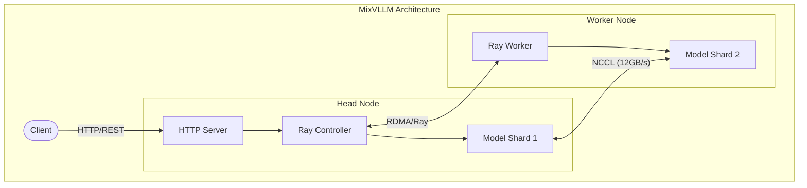

# vLLM Development Environment

A flexible development environment for vLLM that provides:
- Single-machine tensor parallelism and distributed inference
- Python-based configuration management
- Dynamic model deployment system
- Comprehensive parameter customization
- RDMA-optimized networking

The environment uses a YAML-based registry for model configurations, supporting all vLLM parameters and features through a robust Python launcher.

## Deployment Options

### 1. Single Machine Setup
- **GPUs**: 2x NVIDIA GeForce RTX 3090 Ti (24GB VRAM each)
- **CUDA Version**: 12.8
- **Driver**: 570.172.08

### 2. Distributed Cluster Setup
- **Network**: RDMA over Converged Ethernet (RoCE)
- **Bandwidth**: Up to 12 GB/s inter-node communication
- **Requirements**: 
  - RDMA-capable NICs (e.g., Mellanox ConnectX)
  - GPUDirect RDMA support
  - High-bandwidth interconnect

For detailed distributed setup information, see:
- [Docker Configuration Guide](docker/README.md)
- [RDMA Cluster Setup](multi_node_gpu_cluster_with_rdma/setup.md)

## Setup

This project was initialized using `create_project.sh` at the root.

### Install Dependencies

```bash
# Install all dependencies including dev tools
uv sync --all-extras

# Or install without dev dependencies
uv sync
```

### Model Configuration

Models are configured through `docker/config/model_registry.yml`. The configuration system is fully flexible and supports any vLLM parameter - each YAML key is automatically converted to a CLI argument (with `--` prefix).

Common parameters include:
```yaml
model: "path/to/model"              # --model
dtype: "bfloat16"                  # --dtype
tensor-parallel-size: 2            # --tensor-parallel-size
gpu-memory-utilization: 0.35       # --gpu-memory-utilization
max-num-seqs: 8                    # --max-num-seqs
max-model-len: 131072             # --max-model-len
trust-remote-code: true           # --trust-remote-code (flag only if true)
enable-prefix-caching: true       # --enable-prefix-caching (flag only if true)
description: "..."                # (metadata, not passed to vLLM)
```

Example registry entry:
```yaml
gpt-oss-20b:
  model: openai/gpt-oss-20b
  dtype: bfloat16
  tensor-parallel-size: 2
  gpu-memory-utilization: 0.35
  max-num-seqs: 8
  max-model-len: 131072
  swap-space: 4                    # Additional vLLM parameter
  max-num-batched-tokens: 8192     # Additional vLLM parameter
  enable-prefix-caching: true      # Optional feature flag
  description: Lightweight
```

Any valid vLLM parameter can be added to the configuration. The launcher will automatically convert all parameters (except `description`) into appropriate command-line arguments.

### Model Launch System

The Python-based launch system (`docker/config/launch.py`) provides:
- Robust YAML configuration parsing
- Validation of model settings
- Dry-run capability for testing
- User-friendly error messages
- Available models listing

Features:
```bash
# Normal launch
MODEL_NAME=gpt-oss-20b python launch.py

# Validate configuration
MODEL_NAME=gpt-oss-20b python launch.py --dry-run

# See error messages and available models
MODEL_NAME=invalid-model python launch.py
```

### Deployment

1. Set the model in your environment:
```bash
# In .env file
MODEL_NAME=gpt-oss-20b  # Must match an entry in model_registry.yml
```

2. Launch the service:
```bash
cd docker/head  # or docker/worker for distributed setup
docker compose up -d
```

The Python launcher will automatically load and validate the configuration before starting the model.

### Activate Environment

```bash
# Run commands with uv (recommended)
uv run python script.py

# Or activate the virtual environment
source .venv/bin/activate
```


## Project Structure

```
.
├── configs/                           # Configuration files
│   ├── example_model.yaml            # Template configuration
│   ├── llama-70b-tp2.yaml           # Tensor parallel config for Llama 70B
│   ├── llama-7b.yaml                # Single GPU config for Llama 7B
│   └── phi3-mini.yaml               # Configuration for Phi-3 model
├── docker/                          # Docker deployment configurations
│   ├── config/                      # Configuration directory
│   │   ├── launch.py               # Python-based model launcher
│   │   └── model_registry.yml      # Model configurations
│   ├── head/                        # Head node setup
│   │   ├── docker-compose.yml       # Head node container config
│   │   ├── .env.example            # Environment template for head
│   │   └── README.md               # Head node documentation
│   ├── open-webui/                  # Open WebUI + Open Terminal (chat UI)
│   │   └── docker-compose.yml
│   ├── stand_alone/                 # Single node deployment
│   │   └── docker-compose.yml       # Standalone container config
│   └── worker/                      # Worker node setup
│       ├── docker-compose.yml       # Worker node container config
│       ├── .env.exmple             # Environment template for worker
│       └── README.md               # Worker node documentation
├── mixvllm_server/                  # Core server implementation
│   ├── src/                        # Source code
│   │   ├── cli/                    # Command-line interface
│   │   ├── config/                 # Server configuration
│   │   └── inference/              # Inference implementation
│   └── README.md                   # Server documentation
├── multi_node_gpu_cluster_with_rdma/ # RDMA cluster setup guides
│   └── setup.md                    # Detailed RDMA configuration
└── tests/                          # Test suite
    └── tensor_parallel.py          # Tensor parallelism tests
```

## Quick Start

### 1. Test GPU Detection

```bash
uv run python .claude/experiments/test_gpu.py
```

### 2. Test vLLM Installation

```bash
uv run python .claude/experiments/test_vllm.py
```

### 3. Run a Model with Tensor Parallelism

```python
from vllm import LLM

llm = LLM(
    model="meta-llama/Llama-2-70b-hf",
    tensor_parallel_size=2,  # Use both GPUs
    gpu_memory_utilization=0.90,
    trust_remote_code=True
)

outputs = llm.generate("Hello, my name is")
print(outputs[0].outputs[0].text)
```

## Configuration

See `configs/example_model.yaml` for a complete configuration template.

## Development

```bash
# Run tests
uv run pytest

# Type checking
uv run mypy mixvllm/

# Linting
uv run ruff check mixvllm/

# Auto-formatting
uv run black mixvllm/
```

## Tensor Parallelism Notes

With 2x RTX 3090 Ti (24GB each = 48GB total):
- Can run 70B models in FP16 (requires ~140GB, use quantization)
- Can run 70B models in 4-bit quantization comfortably
- Can run 34B models in FP16 easily
- Communication overhead between GPUs is minimal on PCIe 4.0

## Troubleshooting

**Out of Memory Errors:**
- Reduce `gpu_memory_utilization` (try 0.85 or 0.80)
- Use quantization (4-bit or 8-bit)
- Reduce `max_model_len`

**Slow Inference:**
- Check GPU utilization with `nvidia-smi`
- Verify both GPUs are being used
- Ensure PCIe link is running at full speed

**401 Unauthorized Errors:**
- Set `HF_TOKEN` environment variable with your HuggingFace token
- For gated models, request access on the HuggingFace model page
- Verify token has read permissions: `huggingface-cli whoami`
- Some models require accepting terms/conditions on HuggingFace

## Authentication

Some models require authentication to access from HuggingFace. If you encounter `401 Unauthorized` errors, you need to:

### HuggingFace Token Setup

1. **Get a token**: Visit https://huggingface.co/settings/tokens to create an access token
2. **Set environment variable**:
   ```bash
   export HF_TOKEN=hf_xxxxxxxxxxxxxxxxxxxxxxxxx
   ```
3. **Or login via CLI**:
   ```bash
   huggingface-cli login
   ```

### Gated Models

Some models (especially from OpenAI, Meta, etc.) are **gated repositories** that require:
- ✅ Valid HuggingFace account
- ✅ Explicit access approval on the model page
- ✅ Proper authentication token

**Example with authentication:**
```bash
HF_TOKEN=$HF_TOKEN uv run mixvllm-serve --config configs/gpt-oss-20b.yaml
```

**Models that may require authentication:**
- `openai/gpt-oss-20b` (gated)
- `meta-llama/Llama-2-*` (gated)
- `meta-llama/Llama-3-*` (gated)

**Public models (no auth required):**
- `microsoft/Phi-3-mini-4k-instruct`
- Most Microsoft and Google models

## Model Serving

Serve vLLM models with the `serve_model.py` script, which provides an OpenAI-compatible API server.

### Basic Usage

```bash
# Serve Phi-3 Mini on single GPU (no auth required)
uv run mixvllm-serve --model microsoft/Phi-3-mini-4k-instruct --gpus 1

# Serve Llama 2 70B with tensor parallelism (requires HF_TOKEN)
HF_TOKEN=$HF_TOKEN uv run mixvllm-serve --model meta-llama/Llama-2-70b-hf --gpus 2 --trust-remote-code
```

### Using Configuration Files

```bash
# Use predefined configurations
uv run mixvllm-serve --config configs/phi3-mini.yaml          # No auth required
uv run mixvllm-serve --config configs/llama-7b.yaml           # May require HF_TOKEN
HF_TOKEN=$HF_TOKEN uv run mixvllm-serve --config configs/llama-70b-tp2.yaml  # Requires HF_TOKEN
HF_TOKEN=$HF_TOKEN uv run mixvllm-serve --config configs/gpt-oss-20b.yaml    # Requires HF_TOKEN

# Override config with CLI options
uv run mixvllm-serve --config configs/phi3-mini.yaml --port 8080
```

### Advanced Options

```bash
HF_TOKEN=$HF_TOKEN uv run mixvllm-serve \
  --model meta-llama/Llama-2-70b-hf \
  --gpus 2 \
  --gpu-memory 0.85 \
  --max-model-len 4096 \
  --port 8000 \
  --temperature 0.8 \
  --max-tokens 1024
```

### API Usage

Once running, the server provides an OpenAI-compatible API:

```bash
# Health check
curl http://localhost:8000/health

# Chat completion
curl http://localhost:8000/v1/chat/completions \
  -H "Content-Type: application/json" \
  -d '{
    "model": "microsoft/Phi-3-mini-4k-instruct",
    "messages": [{"role": "user", "content": "Hello!"}]
  }'
```

## Chatting with Your Model

For a chat UI, run Open WebUI from [docker/open-webui/](docker/open-webui/). It ships with an Open Terminal container that gives the model a sandboxed shell. Point Open WebUI at the server's OpenAI-compatible endpoint (`http://<host>:8000/v1`). For quick checks, use the `curl` examples above.

## Usage

### Running the gpt-oss-20b Model

To run the `gpt-oss-20b` model using your configuration file, use the following command from the `mixvllm_server` directory:

```bash
HF_TOKEN=<your_huggingface_token> uv run mixvllm-serve --config src/config/gpt-oss-20b.yaml
```

**Notes:**
- Replace `<your_huggingface_token>` with your actual Hugging Face access token.
- This command will use all settings from `src/config/gpt-oss-20b.yaml`, including model name, tensor parallelism, GPU memory, and dtype.
- Make sure your environment has access to the required GPUs and the Hugging Face repository.
- If you encounter quantization or dtype errors, ensure your config file sets `dtype: bfloat16` as shown in the example config.

## Distributed Architecture

## Overview
The system supports both standalone and distributed deployment modes, leveraging Ray for cluster management and RDMA for high-performance communication.



## Deployment Options

### 1. Standalone Mode
For single-node deployment:
```bash
cd docker/stand_alone
docker-compose up -d
```

### 2. Distributed Mode
Head Node:
```bash
cd docker/head
cp .env.example .env
# Configure environment
docker-compose up -d
```

Worker Node:
```bash
cd docker/worker
cp .env.exmple .env
# Configure environment
docker-compose up -d
```

For detailed configuration, see [Docker Configuration Guide](docker/README.md).
