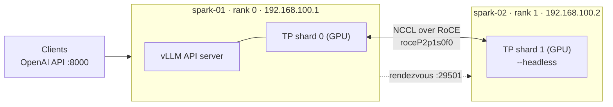

# Distributed LLM Inference with vLLM (2-node, RoCE)

## Overview
Two DGX Spark–class nodes (GB10, 121 GB unified memory each) serve one model with tensor
parallelism 2 across nodes. vLLM's built-in multi-node launcher coordinates the nodes;
NCCL moves tensors between the GPUs over RDMA (RoCE v2, MTU 9000, ~111 Gb/s).

There is **no Ray**. NVIDIA's vLLM container from 26.09 on ships without it, and each node
simply runs `vllm serve` with its own rank.



| | Head (`./head/`) | Worker (`./worker/`) |
|---|---|---|
| Container | `vllm-server` | `vllm-worker` |
| Rank | 0 (serves the API on :8000) | 1 (`--headless`, no API) |
| Image | `VLLM_IMAGE` in `.env`; default `nvidia/vllm:26.09-py3` (vLLM 0.29.0, CUDA 13.4.1) | same (must match) |
| Compile cache | `/mnt/shared/vllm-compile-cache/head` | `/mnt/shared/vllm-compile-cache/worker` |

## Starting and stopping

Start the head first: rank 0 hosts the rendezvous the worker connects to.

```bash
# spark-01
cd docker/head && docker compose up -d
# spark-02
cd docker/worker && docker compose up -d

# wait for "Application startup complete" (about 2 minutes for gpt-oss-120b)
docker logs -f --tail=20 vllm-server
curl http://10.0.0.96:8000/health
```

Stop the worker first, then the head (`docker compose down` in each directory).
If either side has to restart, restart both in that order (worker down, head up, worker up).

## Model configuration

### Registry (`./config/model_registry.yml`)
One entry per model. Every key except `description` becomes a `vllm serve` flag
(`true` → bare flag, `false` → omitted). `model` is passed positionally.

```yaml
models:
  gpt-oss-120b:
    model: openai/gpt-oss-120b
    dtype: bfloat16
    tensor-parallel-size: 2
    gpu-memory-utilization: 0.55
    max-num-seqs: 8
    max-model-len: 131072
    description: Full-capacity
```

Every entry sets `served-model-name: [<own name>, spark]`. A list becomes one flag with several
values. Clients can always request model `spark` and get whichever model is loaded; the model's
own name keeps working too (and is the name reported back in responses).

Set `gpu-memory-utilization` explicitly: vLLM's default (0.92) is too high on unified memory,
where the OS and page cache share the same pool.

### Launcher (`./config/launch.py`)
Both nodes run `python /config/launch.py`. It reads `MODEL_NAME`, looks it up in the registry,
and adds the multi-node flags from the `CLUSTER_*` variables set in each compose file:

| Variable | Head | Worker | Becomes |
|---|---|---|---|
| `CLUSTER_NNODES` | 2 | 2 | `--distributed-executor-backend mp --nnodes 2` |
| `CLUSTER_NODE_RANK` | 0 | 1 | `--node-rank N` (rank > 0 also gets `--headless`) |
| `CLUSTER_MASTER_ADDR` | `${VLLM_HOST_IP}` | 192.168.100.1 | `--master-addr` |
| `CLUSTER_MASTER_PORT` | 29501 | 29501 | `--master-port` |

With `CLUSTER_NNODES` unset or 1, it launches a plain single-node `vllm serve`.

```bash
MODEL_NAME=gpt-oss-120b python launch.py --dry-run       # print the command only
MODEL_NAME=nope python launch.py --dry-run               # lists available models
```

**`MODEL_NAME` must be the same in both nodes' `.env`.** The registry itself comes from the
same git repo on both nodes, so keep them on the same commit.

## Per-node `.env`
Not tracked in git (`docker/*/.env` is ignored; it holds the Hugging Face token).
Key settings:

- `MODEL_NAME`: registry key, identical on both nodes
- `VLLM_HOST_IP`: this node's RDMA-mesh IP (192.168.100.1 / .2)
- `HF_HOME=/mnt/shared/huggingface`: model weights (NFS over RDMA on spark-02)
- `HARMONY_ENCODINGS=/mnt/shared/harmony/encodings`, `TIKTOKEN_ENCODINGS_BASE=/etc/encodings`:
  gpt-oss tokenizer files
- NCCL settings (below)

- `VLLM_IMAGE` / `VLLM_ENTRYPOINT`: which vLLM container to run, identical on both nodes.
  Unset = NGC `26.09-py3` with NVIDIA's entrypoint (it enables CUDA forward compatibility on
  driver 595). For upstream images set e.g. `VLLM_IMAGE=vllm/vllm-openai:v0.32.0` and
  `VLLM_ENTRYPOINT=/usr/bin/env`; their default entrypoint is `vllm serve`, which would swallow
  the launcher command. Some models need a newer vLLM than NGC ships (Qwen3.8-Flash-Next fails
  on 0.29 loading its FP8 n-gram embedding).

Don't set `MASTER_ADDR`, `MASTER_PORT`, `RANK` or `WORLD_SIZE` there: PyTorch reads those
names, and the launcher uses the `CLUSTER_*` variables instead.

## NCCL / RDMA settings
These are hard-won on GB10 unified memory; change them one at a time.

| Setting | Value | Why |
|---|---|---|
| `NCCL_IB_HCA` | `roceP2p1s0f0` | the active RoCE device |
| `NCCL_SOCKET_IFNAME` / `GLOO_SOCKET_IFNAME` | `enP2p1s0f0np0` | keep bootstrap traffic on the mesh |
| `NCCL_NET_GDR_LEVEL` | 0 | GPUDirect RDMA disabled |
| `NCCL_IB_GDR_DMABUF_ENABLE` | 0 | **required**: DMABUF hangs on GB10 with many communicators |
| `NCCL_NET_PLUGIN` | `none` on the head | the HPC-X plugin causes DMABUF hangs |
| `NCCL_IB_TC` / `NCCL_IB_SL` | 106 / 3 | QoS class |
| `NCCL_IB_TIMEOUT` / `NCCL_IB_RETRY_CNT` | 23 / 7 | stability |

Containers get `/dev/infiniband`, `memlock: -1`, and `IPC_LOCK`, `SYS_NICE`, `SYS_RESOURCE`.

### Checking that NCCL really uses RDMA
```bash
docker logs vllm-server 2>&1 | grep -E "NET/IB : Using|via NET/"
# expect: NET/IB : Using [0]roceP2p1s0f0:1/RoCE   and   via NET/IB/0
# bad:    NET/Socket  (TCP fallback)
```
A warning `ibv_query_port_speed failed ... Protocol not supported` at startup is harmless.
Errors with `ibv_reg_mr` / `ENOMEM` are the kernel 7.0 regression pattern: see
`docs/cluster-update-10-20-2026.md`.

## Troubleshooting

- **Head waits forever after loading.** The worker isn't running or can't reach
  `192.168.100.1:29501`. Check `docker logs vllm-worker` on spark-02.
- **Slow first start.** The compile cache is per node under `/mnt/shared/vllm-compile-cache/`.
  It's keyed by vLLM version and model, so stale entries are ignored; delete a node's subdir
  (root-owned, needs sudo) to force a rebuild.
- **"CUDA Forward Compatibility mode ENABLED" in the log.** Expected: the 26.09 image is built
  for CUDA 13.4 (driver 615) and runs on driver 595 via forward compatibility.
- **RDMA bandwidth test** (no sudo): `ib_write_bw -d roceP2p1s0f0 -R -F -q 4 -D 5 --report_gbits`
  on one node, the same plus the other node's mesh IP on the other. Expect ≈111.7 Gb/s.

## References
- [vLLM multi-node serving](https://docs.vllm.ai/en/latest/serving/parallelism_scaling.html)
- [NVIDIA vLLM container release notes](https://docs.nvidia.com/deeplearning/frameworks/vllm-release-notes/)
- [NCCL environment variables](https://docs.nvidia.com/deeplearning/nccl/user-guide/docs/env.html)
