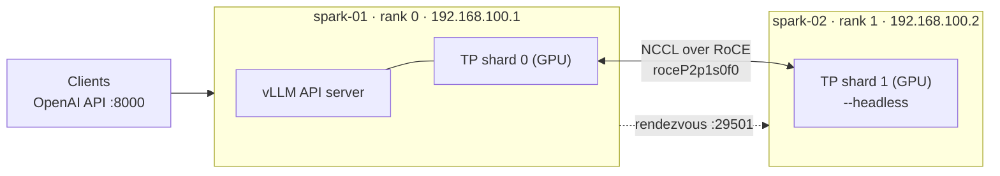

# Distributed LLM Inference with vLLM (2-node, RoCE)

## Overview
Two DGX Spark–class nodes (GB10, 121 GB unified memory each) serve one model with tensor
parallelism 2 across nodes. vLLM's built-in multi-node launcher coordinates the nodes;
NCCL moves tensors between the GPUs over RDMA (RoCE v2, MTU 9000, ~111 Gb/s).

There is **no Ray**: each node simply runs `vllm serve` with its own rank.



Everything about the cluster lives in one tracked file, [`cluster.yml`](cluster.yml): the
machines, the model, the image and every NCCL setting. Every node runs the same
[`node/docker-compose.yml`](node/docker-compose.yml). The `spark-cluster` command on the control
machine renders each node's `docker/node/.env` from `cluster.yml` and starts, stops, checks and
reports on the whole cluster over SSH.

| | spark-01 (rank 0, the head) | spark-02 (rank 1) |
|---|---|---|
| Container | `vllm-server` | `vllm-worker` |
| Role | serves the API on :8000, hosts the rendezvous | `--headless`, no API |
| Model folder | `/mnt/shared` on local NVMe, exported over NFS/RDMA | `/mnt/shared` mounted over NFS/RDMA |
| Compile cache | `/mnt/shared/vllm-compile-cache/spark-01` | `/mnt/shared/vllm-compile-cache/spark-02` |

## Running the cluster: `spark-cluster`
A small uv project at the repo root (dependencies: PyYAML and `rich`). Run it on the control
machine from anywhere in the repo, or install it once with `uv tool install --editable .` to get
`spark-cluster` on the PATH (code edits apply immediately).

```bash
uv run spark-cluster status          # containers, commits, startup stage, /health
uv run spark-cluster up              # check → sync → pull image → start → follow progress
uv run spark-cluster model qwen3.8-27b   # switch model and restart (offers to roll back)
```

| Command | What it does |
|---|---|
| `status` | Per node: container state, restart count, image, git commit (`*` = local changes), the **startup stage** read from the log (`loading weights · pass 1 · 6/11`, `graph capture`, `warmup`, `ready`) and the time since the container started (or until it got ready). Then `/health` and `/v1/models`. |
| `check` | Every node is on local `HEAD` with no changes in `docker/config` or `docker/node`; `MODEL_NAME` is in the registry and its `tensor-parallel-size` × `pipeline-parallel-size` equals the node count; the model's files are complete in the shared folder; a rough memory estimate (checkpoint ÷ GPUs vs `gpu-memory-utilization` × 121 GiB, warning only); host setup (below); `secrets.env` on every node. |
| `sync [--dry-run]` | Write each node's `.env` over SSH, only if it changed. `--dry-run` prints the diff. |
| `download <model>` | Download a registry model into the shared Hugging Face folder, **on the head only** (one copy over NFS; the nodes can't race each other). |
| `up [--timeout MIN] [--no-drop-caches]` | `check`, `sync`, `docker pull` on all nodes, **free memory** (below), then `docker compose up -d` on the head and the other nodes in rank order. Follows progress live until `/health` answers (25 minutes by default); fails fast if a container exits or restarts. Ctrl+C stops watching but leaves the cluster starting. |
| `down` | `docker compose down`, last rank first. |
| `restart` | `down`, then `up`. |
| `logs [node] [--tail N]` | `docker logs -f` on a node (default: the head). |
| `pull` | `git pull --ff-only` on every node; refuses if a node has local changes. |
| `model <name>` | Checks the name, the GPU split and that the files are downloaded; rewrites only the `MODEL_NAME:` line in `cluster.yml` (comments kept); then `restart`. If the new model doesn't come up healthy, offers to switch back and restart. |

**Freeing memory before a start.** vLLM checks free memory against `gpu-memory-utilization` when
the engine starts, and on GB10's unified memory the page cache counts as used. So `up` (and
`restart`, `model`) drops the page cache and compacts memory on every node first, printing free
memory before and after. It needs no sudo: `/proc/sys/vm` isn't namespaced, so a privileged
container (the vLLM image, already on every node) writes the host's settings, which the `docker`
group already allows. `--no-drop-caches` skips it. By hand:
```bash
docker run --rm --privileged --entrypoint /bin/sh vllm/vllm-openai:v0.32.0 \
  -c 'sync; echo 3 > /proc/sys/vm/drop_caches && echo 1 > /proc/sys/vm/compact_memory'
```

Commands that change the cluster (`up`, `down`, `restart`, `sync`, `model`) take a lock on the head
(`/tmp/spark-cluster.lock`, holding the control machine's name and process ID). A second run
refuses and says who holds it; clear a lock left by a dead run with `--force-unlock`.
`-c <file>` points any command at another cluster file (e.g. a scratch copy).
SSH retries briefly on name-lookup and connection errors.

When `up` finishes it prints a **readiness summary**: model load time per node, warmup (last node
loaded → "Application startup complete"), total (head start → ready), the NCCL transport line
(warning if it fell back to TCP), and one test request's time to first token. Each summary is
appended to `docs/startups.csv`, so restarts can be compared from data.

A typical restart of `qwen3.8-flash-next` takes about 11 minutes: ~7 reading the 124 GiB of
weights in two passes (the worker over NFS about as fast as the head from NVMe), ~3 for warmup,
CUDA graph capture and the API server.

Tests (no SSH needed): `uv run pytest`.

### `cluster.yml`
```yaml
repo_path: ~/projects/mixvllm          # checkout on every node
api_url: http://10.0.0.96:8000         # head's API, used for health checks
master_port: 29501

env:                                   # identical on every node
  MODEL_NAME: qwen3.8-flash-next
  VLLM_IMAGE: vllm/vllm-openai:v0.32.0 # one image for all models
  VLLM_ENTRYPOINT: /usr/bin/env
  HF_HOME: /mnt/shared/huggingface
  NCCL_IB_HCA: roceP2p1s0f0
  # ... every NCCL_* value, with why it's set

nodes:                                 # list order = rank; the first node is the head
  - name: spark-01
    ssh: spark-01
    mesh_ip: 192.168.100.1
    env: {NCCL_NET_PLUGIN: none}       # per-node overrides win
  - name: spark-02
    ssh: spark-02
    mesh_ip: 192.168.100.2
```
`spark-cluster` adds per-node values to each `.env`: `NODE_NAME`, `CONTAINER_NAME` (`vllm-server`
on rank 0, `vllm-worker` elsewhere), `VLLM_HOST_IP` (the node's `mesh_ip`), `CLUSTER_NNODES`,
`CLUSTER_NODE_RANK`, `CLUSTER_MASTER_ADDR` (the first node's `mesh_ip`) and `CLUSTER_MASTER_PORT`.
`cluster.yml` must not set those, nor `MASTER_ADDR`, `MASTER_PORT`, `RANK` or `WORLD_SIZE`
(PyTorch reads those names; the launcher uses `CLUSTER_*`).

The image is cluster-wide. If a model needs a different vLLM version, note it in that model's
registry comment and change `VLLM_IMAGE` when switching to it. Upstream images
(`vllm/vllm-openai:v0.32.0`) need `VLLM_ENTRYPOINT=/usr/bin/env`, since their default entrypoint
is `vllm serve` and would swallow the launcher command. NGC images (`nvcr.io/nvidia/vllm:<tag>`)
need `/opt/nvidia/nvidia_entrypoint.sh`, which enables CUDA forward compatibility on driver 595.
Some models need a newer vLLM than NGC ships (Qwen3.8-Flash-Next fails on 0.29 loading its FP8
n-gram embedding).

### Files on each node (`docker/node/`)
- `docker-compose.yml`: tracked, the same on every node.
- `.env`: **generated** by `spark-cluster sync`, gitignored, with a "do not edit" header.
- `secrets.env`: by hand, gitignored, `chmod 600`: `HUGGING_FACE_HUB_TOKEN=...`
  (see [`node/secrets.env.example`](node/secrets.env.example)).

A plain `docker compose up -d` in `docker/node` still works by hand, once `.env` has been synced.

### Adding a node
1. Host setup (below), a checkout at `repo_path` and `docker/node/secrets.env`.
2. Add an entry to `nodes:` in `cluster.yml`.
3. The registry entry's `tensor-parallel-size` × `pipeline-parallel-size` must equal the new
   node count (`check` refuses otherwise): one GPU per node.
4. Commit, `spark-cluster pull`, `spark-cluster restart`.

## Host setup
`check` verifies these on every node: the RDMA device (`/dev/infiniband`) is present, and on nodes
reading the model folder over NFS, `/mnt/shared` is mounted with `proto=rdma` and has read-ahead
≥ 16384 KB. See [`multi_node_gpu_cluster_with_rdma/setup.md`](../multi_node_gpu_cluster_with_rdma/setup.md)
for the RoCE setup itself.

**NFS export over RDMA (spark-01).** `/etc/nfs.conf`:
```ini
[nfsd]
rdma=y
rdma-port=20049
```
`/etc/exports`:
```
/mnt/shared 192.168.100.2(rw,sync,no_subtree_check,no_root_squash)
```
`rpcrdma` is loaded at boot (`/etc/modules-load.d/`).

**RDMA mount (other nodes).** `/etc/fstab` (hard mount: unmount here before rebooting spark-01):
```
192.168.100.1:/mnt/shared  /mnt/shared  nfs  proto=rdma,port=20049,vers=4.1,_netdev  0  0
```

**NFS read-ahead (other nodes).** The default 128 KB makes the worker load weights several times
slower than the head. `/etc/systemd/system/nfs-shared-readahead.service`, enabled with
`sudo systemctl enable --now nfs-shared-readahead.service`:
```ini
[Unit]
Description=Raise read-ahead on /mnt/shared (NFS over RDMA) for model loading
Requires=mnt-shared.mount
After=mnt-shared.mount

[Service]
Type=oneshot
ExecStart=/bin/sh -c 'echo 16384 > /sys/class/bdi/$(mountpoint -d /mnt/shared)/read_ahead_kb'
RemainAfterExit=yes

[Install]
WantedBy=multi-user.target
```

## Model configuration

### Which model to run
**Default: `qwen3.8-flash-next`.** Switch with `uv run spark-cluster model <name>`.
Recommendations come from side-by-side tests on this cluster (vLLM 0.32, server-default effort):

| `MODEL_NAME` | Use for | Speed (tok/s) | Notes |
|---|---|---|---|
| `qwen3.8-flash-next` | **default**: chat, code, vision, tools | 43–51 | only model with zero errors on every coding test, and the best self-written unit tests; 2.7 s short replies. MTP (2 drafts) gives ~1.5× over no MTP. 0.70 memory leaves ~24 GB free per node, 629K-token KV cache. Startup ~11 min (`up` frees memory first, see below) |
| `qwen3.8-27b` | fast restarts; fine-tuning base | 34–44 | strong on images and video; starts in ~6 min with no compaction, leaves ~42 GB free. Keep effort `low` (`medium`/`xhigh` can think until the token limit) |
| `openai/gpt-oss-120b` (`gpt-oss-120b`) | fastest strong text model | 55–58 | no vision; at `high` effort as accurate as Flash-Next on hard code |
| `gemma-4-26b-a4b` | quick chat | 44–50 | fastest replies, but misses edge cases on hard code; weak vision, no audio |
| `deepseek-v4-flash` | general knowledge (largest model) | 26–35 | slowest; uses 85% of memory |

### Registry (`./config/model_registry.yml`)
One entry per model. Every key except `description` becomes a `vllm serve` flag
(`true` → bare flag, `false` → omitted). `model` is passed positionally.

```yaml
models:
  gpt-oss-120b:
    model: openai/gpt-oss-120b
    dtype: bfloat16
    tensor-parallel-size: 2
    gpu-memory-utilization: 0.55
    max-num-seqs: 8
    max-model-len: 131072
    description: Full-capacity
```

Every entry sets `served-model-name: [<own name>, spark]`. A list becomes one flag with several
values. Clients can always request model `spark` and get whichever model is loaded; the model's
own name keeps working too (and is the name reported back in responses).

### Reasoning effort
Server defaults come from `default-chat-template-kwargs` in each registry entry; a request's own
value always wins (vLLM drops unset request values before merging).

| Model | Server default | Per request |
|---|---|---|
| `gemma-4-26b-a4b` | thinking **off** (no effort levels; faster and as accurate in testing) | `"chat_template_kwargs"`: `{"enable_thinking": true}` = on. Any `reasoning_effort` except `none` also turns it on, at full length |
| `qwen3.8-flash-next`, `qwen3.8-27b` | `low` (template default `xhigh`) | `"reasoning_effort"`: `low`, `medium`, `xhigh` (`high` is rejected) |
| `deepseek-v4-flash` | `low` (vLLM default `high`) | `"reasoning_effort"`: `low`, `high`, `max`; `none` = no thinking |
| `openai/gpt-oss-120b` | `medium`, not changeable server-side (Harmony format ignores template defaults) | `"reasoning_effort"`: `low`, `medium`, `high` |

Clients that call the `spark` alias without knowing which model is loaded should only send
`"reasoning_effort": "low"` (accepted by every model) or nothing.

```bash
curl -s http://10.0.0.96:8000/v1/chat/completions -H "Content-Type: application/json" \
  -d '{"model": "spark", "reasoning_effort": "low", "max_tokens": 4000,
       "messages": [{"role": "user", "content": "Explain RDMA in two sentences."}]}'
```

Set `gpu-memory-utilization` explicitly: vLLM's default (0.92) is too high on unified memory,
where the OS and page cache share the same pool.

### Launcher (`./config/launch.py`)
Every node runs `python /config/launch.py`. It reads `MODEL_NAME`, looks it up in the registry,
and adds the multi-node flags from the `CLUSTER_*` variables that `spark-cluster` writes into
each node's `.env`:

| Variable | spark-01 | spark-02 | Becomes |
|---|---|---|---|
| `CLUSTER_NNODES` | 2 | 2 | `--distributed-executor-backend mp --nnodes 2` |
| `CLUSTER_NODE_RANK` | 0 | 1 | `--node-rank N` (rank > 0 also gets `--headless`) |
| `CLUSTER_MASTER_ADDR` | 192.168.100.1 | 192.168.100.1 | `--master-addr` (the first node's `mesh_ip`) |
| `CLUSTER_MASTER_PORT` | 29501 | 29501 | `--master-port` (`master_port` in `cluster.yml`) |

With `CLUSTER_NNODES` unset or 1, it launches a plain single-node `vllm serve`.
`spark-cluster` loads `load_registry` and `get_model_config` from this file by path, so the
registry is parsed the same way everywhere; it must stay a standalone file (inside the container
it needs only PyYAML).

```bash
MODEL_NAME=gpt-oss-120b python launch.py --dry-run       # print the command only
MODEL_NAME=nope python launch.py --dry-run               # lists available models
```

The registry comes from each node's git checkout, so the nodes must be on the same commit
(`spark-cluster check` verifies it; `spark-cluster pull` updates them).

## NCCL / RDMA settings
These are hard-won on GB10 unified memory; change them one at a time, in `cluster.yml`.

| Setting | Value | Why |
|---|---|---|
| `NCCL_IB_HCA` | `roceP2p1s0f0` | the active RoCE device |
| `NCCL_SOCKET_IFNAME` / `GLOO_SOCKET_IFNAME` | `enP2p1s0f0np0` | keep bootstrap traffic on the mesh |
| `NCCL_NET_GDR_LEVEL` | 0 | GPUDirect RDMA disabled |
| `NCCL_IB_GDR_DMABUF_ENABLE` | 0 | **required**: DMABUF hangs on GB10 with many communicators |
| `NCCL_NET_PLUGIN` | `none` on the head | the HPC-X plugin causes DMABUF hangs |
| `NCCL_IB_TC` / `NCCL_IB_SL` | 106 / 3 | QoS class |
| `NCCL_IB_TIMEOUT` / `NCCL_IB_RETRY_CNT` | 23 / 7 | stability |
| `NCCL_DEBUG` / `NCCL_DEBUG_SUBSYS` | `INFO` / `INIT,NET,IB` | `spark-cluster` reads the transport line from the log |

Containers get `/dev/infiniband`, `memlock: -1`, `apparmor:unconfined`, and `IPC_LOCK`,
`SYS_NICE`, `SYS_RESOURCE`.

### Checking that NCCL really uses RDMA
The readiness summary and `status` show it. By hand:
```bash
docker logs vllm-server 2>&1 | grep -E "NET/IB : Using|via NET/"
# expect: NET/IB : Using [0]roceP2p1s0f0:1/RoCE   and   via NET/IB/0
# bad:    NET/Socket  (TCP fallback)
```
A warning `ibv_query_port_speed failed ... Protocol not supported` at startup is harmless.
Errors with `ibv_reg_mr` / `ENOMEM` are the kernel 7.0 regression pattern: see
[`docs/cluster-update-10-20-2026.md`](../docs/cluster-update-10-20-2026.md).

## Troubleshooting

- **Head waits forever after loading.** The worker isn't running or can't reach
  `192.168.100.1:29501`. `spark-cluster status`, then `spark-cluster logs spark-02`.
- **Slow first start.** The compile cache is per node under
  `/mnt/shared/vllm-compile-cache/<node name>`. It's keyed by vLLM version and model, so stale
  entries are ignored; delete a node's subdir (root-owned, needs sudo) to force a rebuild.
- **The worker loads weights much slower than the head.** NFS read-ahead is back at 128 KB
  (`spark-cluster check` shows it): see "NFS read-ahead" under Host setup.
- **"another spark-cluster run holds /tmp/spark-cluster.lock".** Another `up`/`down`/`restart`/
  `sync`/`model` is running. If it died, rerun with `--force-unlock`.
- **ssh: Could not resolve hostname.** Happens now and then from the control machine; every SSH
  call retries a few times before giving up.
- **"CUDA Forward Compatibility mode ENABLED" in the log.** Expected with NGC images: 26.09 is
  built for CUDA 13.4 (driver 615) and runs on driver 595 via forward compatibility.
- **RDMA bandwidth test** (no sudo): `ib_write_bw -d roceP2p1s0f0 -R -F -q 4 -D 5 --report_gbits`
  on one node, the same plus the other node's mesh IP on the other. Expect ≈111.7 Gb/s.

## References
- [vLLM multi-node serving](https://docs.vllm.ai/en/latest/serving/parallelism_scaling.html)
- [NVIDIA vLLM container release notes](https://docs.nvidia.com/deeplearning/frameworks/vllm-release-notes/)
- [NCCL environment variables](https://docs.nvidia.com/deeplearning/nccl/user-guide/docs/env.html)
