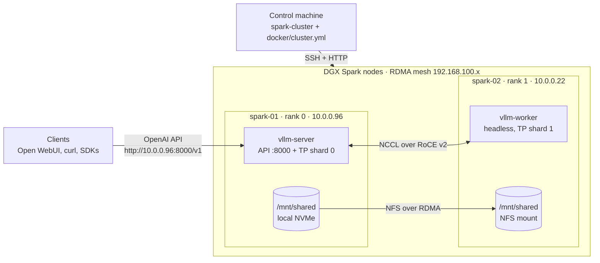
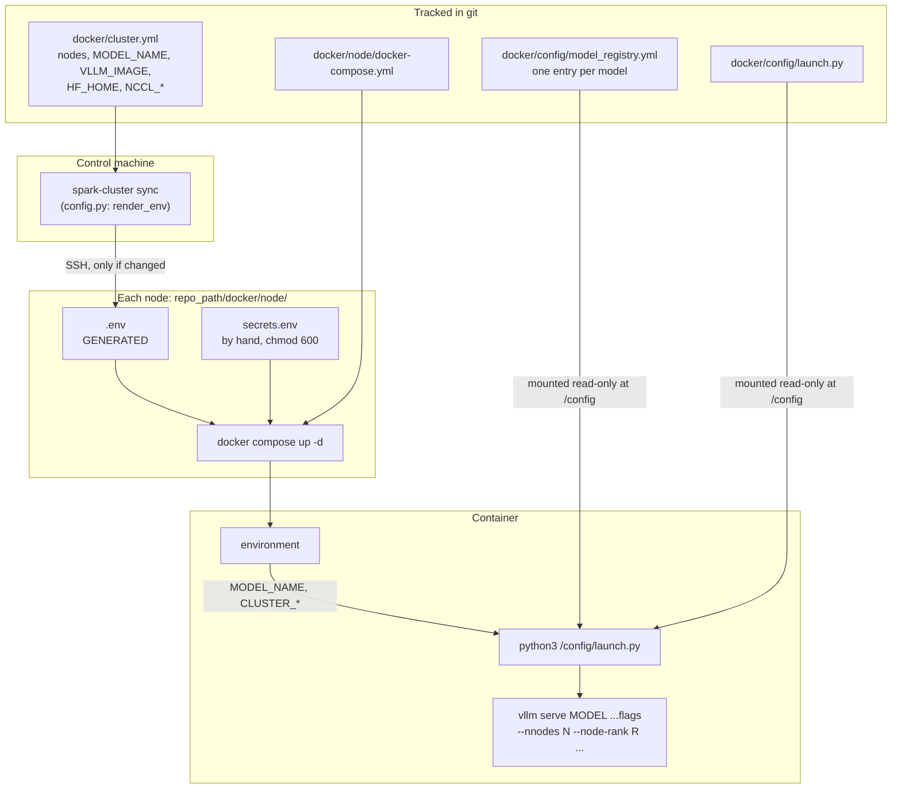
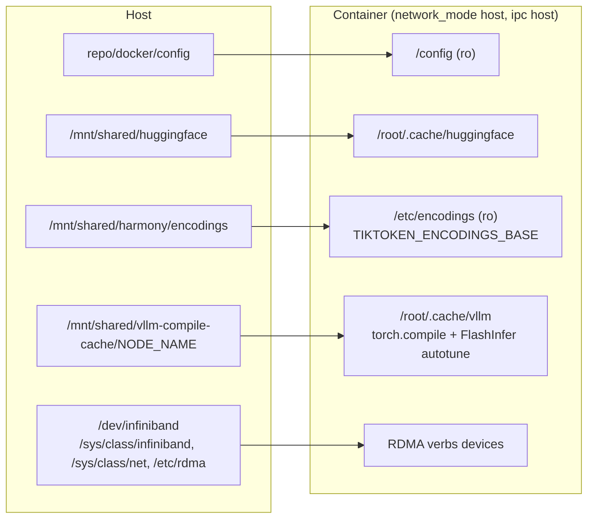
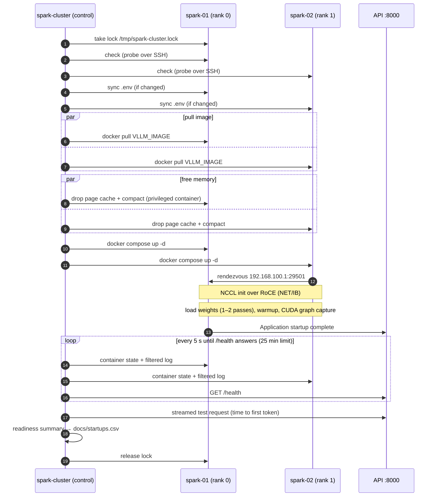
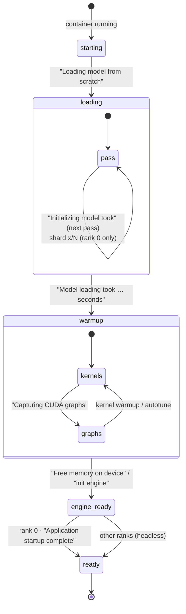
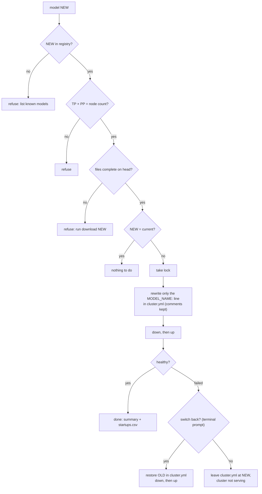
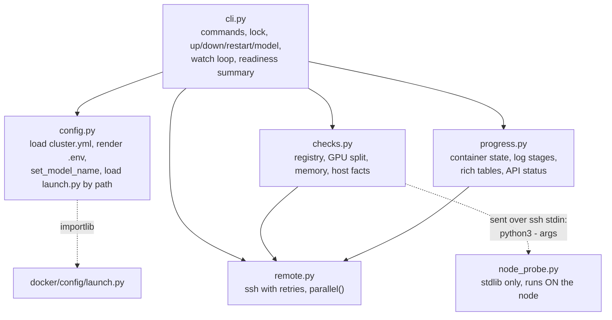

# Architecture

How the mixvllm cluster is put together: the machines and networks, how one configuration file
becomes a running `vllm serve` on every node, what happens during a start, and how the
`spark-cluster` command is built. For day-to-day commands see
[docker/README.md](../docker/README.md); for the RoCE host setup see
[multi_node_gpu_cluster_with_rdma/setup.md](../multi_node_gpu_cluster_with_rdma/setup.md).

## 1. System overview

Two DGX Spark nodes (GB10 Grace Blackwell, one GPU and 121 GB of unified memory each) serve one
model together with tensor parallelism across the nodes. A control machine (any Linux box with
`uv` and SSH access) drives them. Each node runs `vllm serve` with its own rank, and vLLM's
built-in multi-process launcher coordinates them.



| | spark-01 | spark-02 |
|---|---|---|
| Rank | 0 (head) | 1 |
| Management IP | 10.0.0.96 | 10.0.0.22 |
| Mesh (RDMA) IP | 192.168.100.1 | 192.168.100.2 |
| Container | `vllm-server` | `vllm-worker` |
| Serves the API | yes, `:8000` | no (`--headless`) |
| `/mnt/shared` | local NVMe, exported over NFS/RDMA | NFS/RDMA mount, 16 MB read-ahead |

### Three kinds of traffic

| Traffic | Network | Path |
|---|---|---|
| API requests | management (10.0.0.x) | clients → spark-01:8000 |
| Tensors between GPUs | RDMA mesh (192.168.100.x) | NCCL over RoCE v2 (`roceP2p1s0f0`), about 111 Gb/s; bootstrap over `enP2p1s0f0np0` |
| Model weights, caches | RDMA mesh | NFS v4.1 over RDMA from spark-01's `/mnt/shared` |
| Control | management | SSH and HTTP from the control machine |

The model folder lives once, on spark-01's NVMe, and spark-02 reads it over NFS/RDMA. With
read-ahead raised to 16 MB, spark-02 loads weights about as fast as spark-01 does locally. One copy
per model also means only one node may download a model at a time (`spark-cluster download` runs
on the head only).

## 2. Configuration: from one file to a running process

Two tracked files describe everything: `docker/cluster.yml` (the machines and every shared
setting) and `docker/config/model_registry.yml` (one entry per model). Nothing on a node is edited
by hand except the token file.



### What goes into a node's `.env`

`config.node_env()` builds it in this order, later entries winning:

1. **Derived per node** (`cluster.yml` must not set these): `NODE_NAME`, `CONTAINER_NAME`
   (`vllm-server` on rank 0, `vllm-worker` elsewhere), `VLLM_HOST_IP` (the node's `mesh_ip`),
   `CLUSTER_NNODES`, `CLUSTER_NODE_RANK` (list position), `CLUSTER_MASTER_ADDR` (the first node's
   `mesh_ip`), `CLUSTER_MASTER_PORT`.
2. **Shared** `env:` from `cluster.yml`: `MODEL_NAME`, `VLLM_IMAGE`, `VLLM_ENTRYPOINT`, host paths,
   all `NCCL_*`.
3. **The node's own** `env:`, e.g. `NCCL_NET_PLUGIN: none` on spark-01.

The `.env` serves two purposes in compose: it supplies `${...}` interpolation in the compose file
(image, entrypoint, container name, volume paths) and, through `env_file`, the container's
environment. The compose file's own `environment:` block adds fixed values (`HF_HOME` inside the
container, `CUDA_VISIBLE_DEVICES=0`, `GLOO_SOCKET_IFNAME=${NCCL_SOCKET_IFNAME}`) and repeats the
`CLUSTER_*` values with `:?` guards, so a node without a synced `.env` refuses to start.

### From `MODEL_NAME` to `vllm serve`

`launch.py` looks up `MODEL_NAME` in the registry and turns every key except `description` into a
flag (`true` → bare flag, `false` → omitted, list → one flag with several values; `model` is
positional). With `CLUSTER_NNODES > 1` it appends:

```
--distributed-executor-backend mp --nnodes N --node-rank R
--master-addr <CLUSTER_MASTER_ADDR> --master-port <CLUSTER_MASTER_PORT>
[--headless]   # every rank but 0
```

`launch.py` stays a standalone file because it runs inside the vLLM container with only PyYAML.
`spark-cluster` loads it by path (`importlib`) and reuses `load_registry` and `get_model_config`,
so the registry is parsed one way everywhere. Because each node reads the registry from its own
checkout, all nodes must be on the same commit; `spark-cluster check` enforces it.

### Inside a node container



The container runs with host networking (the API binds :8000 directly on spark-01; NCCL and the
rendezvous use the mesh interfaces), `memlock: -1`, capabilities `IPC_LOCK`, `SYS_NICE`,
`SYS_RESOURCE`, and `apparmor:unconfined`. The compile cache is per node so the two nodes never
write the same files over NFS.

## 3. Starting the cluster (`spark-cluster up`)



Notes on the steps:

- **Check** refuses to start on any failure: nodes on a different commit than the control
  machine, local changes in `docker/config` or `docker/node`, a model missing from the registry,
  `tensor-parallel-size × pipeline-parallel-size` not equal to the node count, model files
  incomplete, no RDMA device, NFS not over RDMA or read-ahead below 16 MB, or `secrets.env`
  missing. The memory estimate (checkpoint ÷ GPUs vs `gpu-memory-utilization × 121 GiB`) only
  warns.
- **Free memory.** vLLM compares free memory with `gpu-memory-utilization` when the engine starts,
  and on unified memory the page cache counts as used: after a `down`, each node typically shows
  60–65 GiB free until the cache is dropped, then about 119 GiB. `/proc/sys/vm` is not namespaced,
  so a privileged container (the vLLM image, already on every node) writes the host's
  `drop_caches` and `compact_memory`; the `docker` group already allows this, so no sudo is
  needed.
- **Order.** Rank 0 starts first because it hosts the rendezvous; the others connect to it.
  `down` stops in reverse order.
- **Fail fast.** The watch stops with the node's last error line if a container exits, restarts
  or disappears. Ctrl+C stops watching but leaves the cluster starting.

### Startup stages (as `status` reports them)

`progress.parse_log()` reads `docker logs --timestamps --since <container start>`, filtered on the
node to the marker lines below, and moves each node forward through these stages:



Measured on `qwen3.8-flash-next` (124 GiB checkpoint, read in two passes): about 6.5 minutes of
loading, 3.5 minutes of warmup and graph capture, about 11 minutes in total. `gpt-oss-120b`
(61 GiB, one pass) is ready in a little over 2 minutes. Every `up` appends its timings to
`docs/startups.csv` on the control machine (gitignored: a local history, not shared).

The **readiness summary** derives:

| Field | From |
|---|---|
| model load per node | "Model loading took … seconds" |
| warmup | rank 0's "Application startup complete" − the latest "Model loading took" timestamp |
| total | rank 0's "Application startup complete" − rank 0's container start |
| NCCL | rank 0's `NET/IB : Using …` line (a `NET/Socket` line means TCP fallback and is flagged) |
| first token | one streamed `/v1/chat/completions` request to model `spark` |

## 4. Switching models (`spark-cluster model <name>`)



The change to `cluster.yml` is local to the control machine; commit it if the new model should
stay the default. Every registry entry serves its own name plus the alias `spark`, so clients
that ask for `spark` keep working across switches.

## 5. The `spark-cluster` command

A small uv project at the repo root (`pyproject.toml`, `uv.lock`), depending only on PyYAML and
`rich`. It runs on the control machine; the nodes need only `python3`, git and Docker.



Design points:

- **One SSH round trip per node per poll.** `status` runs a single script per node that prints the
  git commit, `docker inspect` state and the log filtered on the node (`grep -E` on
  `progress.LOG_FILTER`), so long-running containers don't ship hours of request logs.
- **Probes need nothing installed.** `node_probe.py` is sent over stdin to the node's `python3`
  and prints JSON: commit, local changes, `secrets.env` presence, RDMA devices, the mount behind
  `HF_HOME` (from `/proc/self/mountinfo`, including `proto=rdma`), its read-ahead
  (`/sys/class/bdi/<dev>/read_ahead_kb`), and on the head whether the model's files are complete
  in the Hugging Face cache.
- **Retries.** SSH errors that look transient (name lookup, refused, timed out, reset) are retried
  up to 4 attempts with 2, 4 and 8 s back-off; the control machine occasionally fails to resolve a
  node's name.
- **One changing run at a time.** `up`, `down`, `restart`, `sync` and `model` create
  `/tmp/spark-cluster.lock` on the head atomically (`set -C`), holding the control machine's name,
  PID and time, and remove it on exit if it is still theirs. A second run refuses and names the
  holder; `--force-unlock` clears a lock left by a dead run.
- **Plain output when piped.** With a terminal, `rich` tables and a live view; without one, one line
  per node, printed only when a node's state or stage changes.
- **Tests without hardware.** `uv run pytest` covers `.env` rendering, the check logic and stage
  parsing; the log fixtures in `tests/data/` are real startups captured with `LOG_FILTER`.

## 6. Failure modes and where they show

| Symptom | Where it shows | Usual cause |
|---|---|---|
| `check`: commit differs | before any start | a node wasn't pulled (`spark-cluster pull`) |
| `check`: read-ahead below 16384 KB | before any start | `nfs-shared-readahead.service` didn't run on spark-02 |
| head stuck after loading, `/health` never answers | `status`, watch timeout | a worker isn't running or can't reach 192.168.100.1:29501 |
| `NET/Socket` instead of `NET/IB` | `status` warning, readiness summary | NCCL fell back to TCP: RDMA device or HCA setting |
| container exits during start | watch stops with the last error line | memory (utilization too high), model or image mismatch |
| "another spark-cluster run holds the lock" | any changing command | a run in progress, or a dead one (`--force-unlock`) |
| `docker compose up` refuses on a node | by hand on the node | `.env` never synced (`spark-cluster sync`) |

## 7. Single machine

[docker/stand_alone/](../docker/stand_alone/) runs the same `launch.py` and registry on one
machine without the cluster pieces: no RDMA devices, no `CLUSTER_*` variables (so plain
`vllm serve`), and port 8000 published instead of host networking. It is outside `spark-cluster`.
